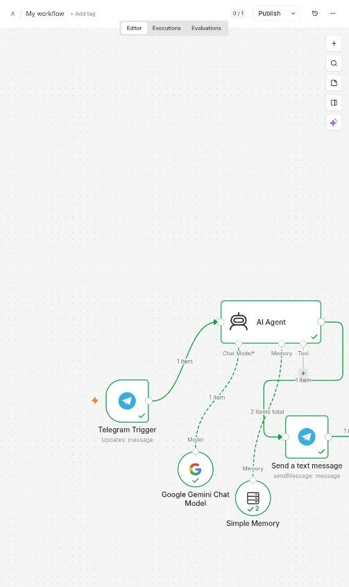
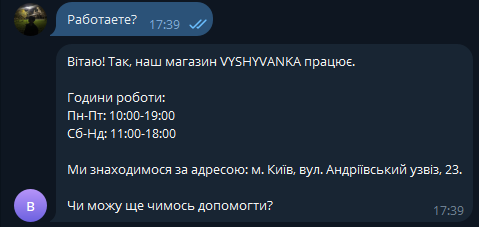
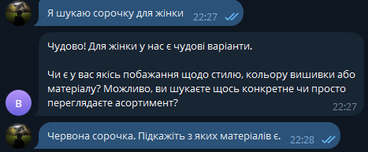
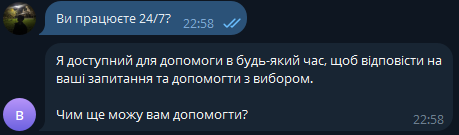

# VYSHYVANKA — AI-Powered Telegram Sales Assistant

**Навчальний проєкт з автоматизації клієнтської підтримки за допомогою штучного інтелекту.**

[Українська версія](#українська-версія) | [English Version](#english-version)

---

# Українська версія

## 1. Огляд проєкту

VYSHYVANKA — демонстраційний AI-чатбот для вигаданого інтернет-магазину українського традиційного одягу.

Проєкт створено для автоматизації первинної комунікації з клієнтами, надання інформації про товари, допомоги з вибором продукції та відповідей на типові запитання.

Чатбот використовує Google Gemini для обробки природної мови та n8n для побудови автоматизованого workflow.

**Основна мета:** продемонструвати можливості інтеграції AI, месенджерів та інструментів автоматизації для вирішення бізнес-завдань.

## 2. Основний функціонал

- **AI Customer Support:** автоматизована обробка повідомлень клієнтів через Telegram.
- **Customer Intent Classification:** визначення намірів клієнта та розподіл на три категорії: інформаційний, зацікавлений у покупці та готовий до покупки.
- **Product Recommendations:** рекомендації товарів на основі запиту клієнта та доступного каталогу.
- **Conversational Memory:** збереження контексту попередніх повідомлень для підтримки послідовного діалогу.
- **Knowledge-Based Responses:** використання визначеної бази знань магазину для відповідей щодо асортименту, розмірів, доставки, оплати та повернення.
- **Hallucination Control:** системні інструкції, що обмежують використання непідтвердженої інформації та передбачають повідомлення про відсутність необхідних даних.

## 3. Архітектура рішення

Workflow побудований у n8n та складається з таких компонентів:

| Компонент | Призначення |
|---|---|
| Telegram Trigger | Отримання повідомлень від клієнтів |
| AI Agent | Обробка запитів та формування відповідей |
| Google Gemini 2.5 Flash | Мовна модель для обробки природної мови |
| Simple Memory | Збереження контексту діалогу |
| Telegram Send Message | Надсилання відповідей клієнтам |

### Схема роботи

1. Клієнт надсилає повідомлення Telegram-боту.
2. Telegram Trigger передає повідомлення до AI Agent.
3. AI Agent використовує Google Gemini для аналізу запиту.
4. Simple Memory забезпечує доступ до контексту попереднього діалогу.
5. AI Agent формує відповідь відповідно до бізнес-правил та інформації з бази знань.
6. Telegram Send Message надсилає відповідь клієнту.

## 4. Технологічний стек

- **n8n** — платформа автоматизації workflow.
- **Google Gemini 2.5 Flash** — велика мовна модель (LLM).
- **Telegram Bot API** — інтеграція з месенджером.
- **AI Agent (LangChain integration)** — обробка запитів та взаємодія з мовною моделлю.
- **Simple Memory** — контекстна пам'ять діалогу.

## 5. Бізнес-логіка та правила взаємодії

Для забезпечення послідовної комунікації розроблено системний промпт, який визначає:

- три категорії клієнтів та відповідні стратегії комунікації;
- правила рекомендації товарів;
- використання розмірних сіток;
- обмеження щодо генерації непідтверджених характеристик та цін;
- правила обробки запитів, на які немає відповіді в базі знань;
- тональність та структуру повідомлень.

База знань магазину включає каталог продукції, характеристики товарів, розмірні сітки, умови доставки й оплати, правила повернення та відповіді на поширені запитання.

## 6. Демонстрація проєкту

### Архітектура workflow

*Загальна схема автоматизації та взаємодії компонентів у n8n.*

### Консультація щодо товару

*Приклад обробки запиту щодо товару, якого немає в описаному асортименті. Чатбот повідомляє про відсутність відповідної інформації та пропонує уточнити потребу клієнта.*

### Інформація про магазин

*Приклад надання інформації про графік роботи та фізичну адресу магазину.*

### Цілодобова підтримка клієнтів

*Чатбот доступний для первинної допомоги та консультацій цілодобово, зокрема поза межами робочого часу магазину.*

## 7. Встановлення та запуск

Для відтворення проєкту необхідні:

- обліковий запис n8n;
- Telegram Bot Token;
- Google Gemini API Key.

### Інструкція

1. Завантажити `workflow/workflow-public.json`.
2. Імпортувати JSON-файл у n8n.
3. Створити власні credentials для Telegram Bot API.
4. Налаштувати підключення Google Gemini API.
5. Призначити відповідні credentials вузлам Telegram та Google Gemini.
6. Перевірити конфігурацію Telegram Trigger.
7. Активувати workflow та протестувати взаємодію з ботом.

**Примітка:** оригінальне демонстраційне середовище більше не активне. Для повторного запуску необхідно налаштувати власне середовище та підключення.

## 8. Обмеження поточної версії

- База знань інтегрована безпосередньо в системний промпт.
- Передача запитів менеджеру описана в бізнес-правилах, але окремий механізм автоматичної ескалації не реалізований.
- Обробка нетекстових повідомлень не передбачена в поточній версії.
- Проєкт не інтегрований із реальною системою обліку товарів або замовлень.
- Поточна версія є демонстраційним прототипом, а не готовою production-системою.

---

# English Version

## 1. Project Overview

VYSHYVANKA is a demonstration AI-powered Telegram chatbot developed for a fictional Ukrainian traditional clothing store.

The project aims to automate initial customer communication, provide product information, assist with product selection, and answer frequently asked questions.

The chatbot uses Google Gemini for natural language processing and n8n to orchestrate the automation workflow.

**Main objective:** to demonstrate how AI, messaging platforms, and workflow automation tools can be integrated to solve practical business problems.

## 2. Key Features

- **AI Customer Support:** automated processing of customer messages through Telegram.
- **Customer Intent Classification:** identification of customer intent and classification into three categories: informational, interested in purchasing, and ready to purchase.
- **Product Recommendations:** product suggestions based on customer requests and the available product catalogue.
- **Conversational Memory:** retention of previous conversation context to support consistent interactions.
- **Knowledge-Based Responses:** use of a predefined store knowledge base covering products, sizing, delivery, payment, and returns.
- **Hallucination Control:** system instructions designed to limit unsupported information and handle situations where the required information is unavailable.

## 3. Solution Architecture

The workflow is built in n8n and consists of the following components:

| Component | Purpose |
|---|---|
| Telegram Trigger | Receives customer messages |
| AI Agent | Processes requests and generates responses |
| Google Gemini 2.5 Flash | Large language model for natural language processing |
| Simple Memory | Maintains conversation context |
| Telegram Send Message | Delivers responses to customers |

### Workflow Execution

1. A customer sends a message to the Telegram bot.
2. Telegram Trigger forwards the message to the AI Agent.
3. The AI Agent uses Google Gemini to process the request.
4. Simple Memory provides access to previous conversation context.
5. The AI Agent generates a response based on predefined business rules and the knowledge base.
6. Telegram Send Message delivers the response to the customer.

## 4. Technology Stack

- **n8n** — workflow automation platform.
- **Google Gemini 2.5 Flash** — Large Language Model (LLM).
- **Telegram Bot API** — messaging platform integration.
- **AI Agent (LangChain integration)** — request processing and interaction with the language model.
- **Simple Memory** — conversational context management.

## 5. Business Logic and Interaction Rules

A dedicated system prompt was developed to define consistent chatbot behavior, including:

- Three customer categories and corresponding communication strategies.
- Product recommendation rules.
- Product sizing guidelines.
- Restrictions on generating unsupported product characteristics and prices.
- Handling requests when the required information is unavailable.
- Communication tone and response structure.

The store knowledge base includes a product catalogue, product descriptions, size charts, delivery and payment policies, return conditions, and frequently asked questions.

## 6. Project Demonstration

### Workflow Architecture

*Overview of the automation workflow and component interactions in n8n.*

### Product Consultation

*Example of handling a request about a product that is not included in the defined catalogue. The chatbot communicates the information limitation and asks a relevant follow-up question.*

### Store Information

*Example of providing store information, including business hours and physical address.*

### 24/7 Customer Support

*The chatbot remains available 24/7, allowing customers to receive initial assistance and product information outside the store's regular business hours.*

## 7. Installation and Setup

Requirements:

- An n8n account.
- A Telegram Bot Token.
- A Google Gemini API Key.

### Setup Instructions

1. Download `workflow/workflow-public.json`.
2. Import the JSON workflow into n8n.
3. Create your own Telegram Bot API credentials.
4. Configure Google Gemini API credentials.
5. Assign the appropriate credentials to the Telegram and Google Gemini nodes.
6. Verify the Telegram Trigger configuration.
7. Activate the workflow and test the chatbot.

**Note:** The original demonstration environment is no longer active. Recreating the project requires configuring your own environment and credentials.

## 8. Current Limitations

- The knowledge base is embedded directly in the system prompt.
- Human support escalation is described in the business rules, but an automated escalation mechanism has not been implemented.
- Non-text message processing is not supported in the current version.
- The project is not integrated with a real inventory or order management system.
- This version is a demonstration prototype rather than a production-ready solution.

---

**Project Type:** Personal / Educational Project  
**Status:** Completed Prototype  
**Automation Platform:** n8n  
**AI Model:** Google Gemini 2.5 Flash